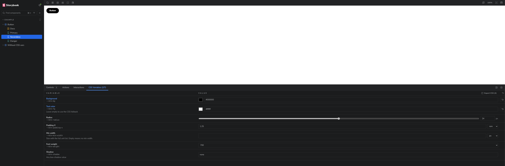

# @faebeee/storybook-addon-css-vars

Edit CSS custom properties per story from a **CSS Variables** panel and see the story update instantly, similar to args and the Controls panel.

- Configured per story (or per component) with the `cssVars` parameter
- Control types: `color`, `number` (with fixed unit), `size` (number with unit dropdown), `select`, `text`
- Variables are set on the story's own root element, so stories and docs-page stories don't affect each other
- Changes are stored in the URL, so a link reproduces exactly what you see
- Export the changed variables as ready-to-copy CSS
- Renderer-agnostic (React, Vue, Angular, Web Components, Svelte, ...)
- Requires Storybook 10



## Install

```sh
npm i -D @faebeee/storybook-addon-css-vars
```

```ts
// .storybook/main.ts
export default {
  addons: ['@faebeee/storybook-addon-css-vars'],
};
```

## Usage

```ts
import type { CssVarsParameter } from '@faebeee/storybook-addon-css-vars';

const cssVars: CssVarsParameter = {
  '--btn-bg': { type: 'color', default: '#1ea7fd', label: 'Background' },
  '--btn-radius': { type: 'number', default: 4, unit: 'px', min: 0, max: 32, step: 1 },
  '--btn-gap': { type: 'size', default: '0.5rem' }, // unit dropdown: px, rem, em, %, fr, vw, vh, ch
  '--btn-col': { type: 'size', default: '1fr', units: ['fr', '%', 'px'] },
  '--btn-weight': { type: 'select', default: '500', options: ['400', '500', '700'] },
  '--btn-tone': {
    type: 'select',
    options: { Primary: 'var(--color-primary)', Danger: 'var(--color-danger)' }, // label -> value
  },
  '--btn-shadow': { type: 'text', default: 'none', description: 'Any box-shadow value' },
};

export default {
  component: Button,
  parameters: { cssVars },
};

// Story-level parameters merge with the component-level ones:
export const Danger = {
  parameters: { cssVars: { '--btn-bg': { type: 'color', default: '#e5484d' } } },
};
```

Your CSS reads the variables as usual, ideally with a fallback:

```css
.button {
  background: var(--btn-bg, #1ea7fd);
  border-radius: var(--btn-radius, 4px);
}
```

### Config reference

| Key           | Types            | Description                                                                         |
| ------------- | ---------------- | ----------------------------------------------------------------------------------- |
| `type`        | all              | `'color' \| 'number' \| 'size' \| 'select' \| 'text'`                               |
| `default`     | all              | Initial value. If omitted the variable is not set and your CSS fallback applies.    |
| `label`       | all              | Label in the panel (the variable name is shown below it)                            |
| `description` | all              | Help text in the panel                                                              |
| `unit`        | `number`         | Fixed unit appended to the value, e.g. `px`, `rem`, `%`                             |
| `unit`        | `size`           | Unit preselected when `default` has none (default: first entry of `units`)          |
| `units`       | `size`           | Units in the dropdown (default: `px`, `rem`, `em`, `%`, `fr`, `vw`, `vh`, `ch`)     |
| `min` / `max` | `number`, `size` | With both set, a slider is shown next to the input (for `size` it ignores the unit) |
| `step`        | `number`, `size` | Step for slider and input (default `1`)                                             |
| `options`     | `select`         | `string[]` or `{ label: value }`                                                    |

## Export changed variables

**Export CSS** in the panel header opens a dialog with a CSS rule that contains only the variables you changed in the current story, with their final values (units included). You can set the selector (default `:root`) and copy the CSS to the clipboard.


```css
:root {
  --btn-bg: #ff0066;
  --btn-min-width: 50%;
}
```

## How it works

- Panel edits are stored in the Storybook global `cssVars`. Only variables declared by the current story are applied or shown.
- A decorator sets the resolved values with `style.setProperty()` on the story's canvas element (`#storybook-root` in story view, the story container on docs pages) and removes them when the story changes.
- Storybook only puts "simple" values into the URL. Values such as `var(--x)` or `0 1px 2px rgba(0,0,0,.2)` are stored base64url-encoded (prefix `b64_`) so they survive in shared links.

### Limitations

- Content rendered outside the story root (portals, modals appended to `body`) does not inherit the variables. Render portals into the story root, or set the variables on `:root` yourself in a custom decorator using the exported `withCssVars` as a starting point.
- The color picker only shows hex colors. Any other CSS color can be typed into the text field next to it.

## Development

```sh
npm install
npm start        # tsup watch + demo Storybook on :6006
npm test         # unit tests (vitest)
npm run typecheck
npm run lint
npm run build
```

Source lives in `src/`: `preview.ts` / `withCssVars.ts` (decorator), `manager.tsx` / `components/` (panel), `utils/` (value resolution and URL encoding). Demo stories are in `src/stories/`.
