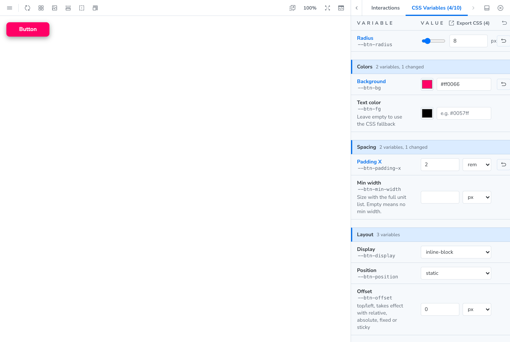
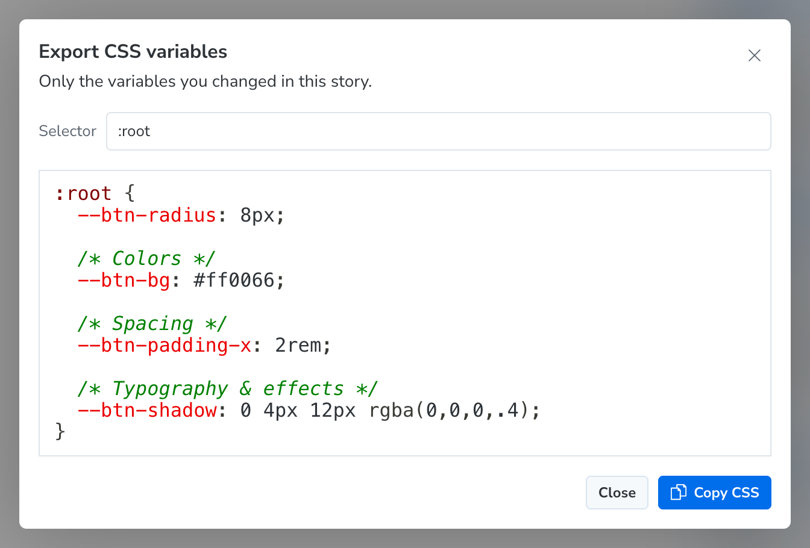

# @faebeee/storybook-addon-css-vars

Edit CSS custom properties per story from a **CSS Variables** panel and see the story update instantly, similar to args and the Controls panel.

- Configured per component or per story with the `cssVars` parameter
- Control types: `color`, `number`, `size` (number with unit dropdown), `position`, `display`, `select`, `text`
- Group variables under labelled sections
- Export the changed variables as ready-to-copy CSS
- Changes are stored in the URL, so a link reproduces exactly what you see
- Variables are set on the story's own root element, so stories and docs-page stories don't affect each other
- Renderer-agnostic (React, Vue, Angular, Web Components, Svelte, ...)
- Requires Storybook 10



## Install

```sh
npm i -D @faebeee/storybook-addon-css-vars
```

```ts
// .storybook/main.ts
export default {
  addons: ['@faebeee/storybook-addon-css-vars'],
};
```

If you use [CSF Factories](https://storybook.js.org/docs/api/csf/csf-factories), also add it to your preview:

```ts
// .storybook/preview.ts
import { definePreview } from '@storybook/react-vite';
import cssVarsAddon from '@faebeee/storybook-addon-css-vars';

export default definePreview({
  addons: [cssVarsAddon()],
});
```

## Usage

Declare the variables a component exposes with the `cssVars` parameter. The key is the variable name, the value describes the control.

```ts
import type { CssVarsParameter } from '@faebeee/storybook-addon-css-vars';

const cssVars: CssVarsParameter = {
  '--btn-bg': { type: 'color', default: '#1ea7fd', label: 'Background' },
  '--btn-radius': { type: 'number', default: 4, unit: 'px', min: 0, max: 32 },
  '--btn-gap': { type: 'size', default: '0.5rem' },
  '--btn-col': { type: 'size', default: '1fr', units: ['fr', '%', 'px'] },
  '--btn-display': { type: 'display', default: 'inline-flex' },
  '--btn-position': { type: 'position', default: 'relative' },
  '--btn-weight': { type: 'select', default: '500', options: ['400', '500', '700'] },
  '--btn-tone': {
    type: 'select',
    options: { Primary: 'var(--color-primary)', Danger: 'var(--color-danger)' }, // label -> value
  },
  '--btn-shadow': { type: 'text', default: 'none', description: 'Any box-shadow value' },
};

export default {
  component: Button,
  parameters: { cssVars },
};
```

Your CSS reads the variables as usual, ideally with a fallback:

```css
.button {
  background: var(--btn-bg, #1ea7fd);
  border-radius: var(--btn-radius, 4px);
}
```

If a variable has no `default` and you haven't changed it, it is not set at all, so the fallback in your CSS applies.

### Story-level overrides

Story parameters are deep-merged with the component parameters, like any Storybook parameter. A story can add variables or change single fields of an existing one. All other fields, such as `label` or `group`, are kept.

```ts
export const Danger = {
  parameters: {
    cssVars: {
      '--btn-bg': { default: '#e5484d' }, // keeps type, label and group from the component
      '--btn-border': { type: 'color', default: '#000' }, // only in this story
    },
  },
};
```

With TypeScript, a partial entry like `{ default: '#e5484d' }` does not match `CssVarsParameter`. Leave the annotation off for story-level overrides, or repeat the `type`.

### Control types

| Type       | Control                                                                                                                                              | Applied value                    |
| ---------- | ---------------------------------------------------------------------------------------------------------------------------------------------------- | -------------------------------- |
| `color`    | Color picker plus a text field for any CSS color (`#hex`, `rgb()`, `hsl()`, names, `var()`)                                                          | as entered                       |
| `number`   | Number input, plus a slider when `min` and `max` are set. The unit is fixed by the config.                                                           | number + `unit`, e.g. `4px`      |
| `size`     | Number input and a unit dropdown, plus a slider when `min` and `max` are set                                                                         | number + selected unit, `1.5rem` |
| `position` | Dropdown with `static`, `relative`, `absolute`, `fixed`, `sticky`                                                                                    | as selected                      |
| `display`  | Dropdown with `block`, `inline`, `inline-block`, `flex`, `inline-flex`, `grid`, `inline-grid`, `flow-root`, `contents`, `list-item`, `table`, `none` | as selected                      |
| `select`   | Dropdown with your own `options`                                                                                                                     | value of the selected option     |
| `text`     | Text field for any CSS value                                                                                                                         | as entered                       |

### Groups

Give variables a `group` to show them together under a labelled header in the panel. Variables without a group come first, then the groups in the order they first appear in the config. Each header shows how many variables the group has and how many of them you changed.

```ts
const cssVars: CssVarsParameter = {
  '--btn-radius': { type: 'number', unit: 'px' }, // no group: shown first
  '--btn-bg': { type: 'color', group: 'Colors' },
  '--btn-fg': { type: 'color', group: 'Colors' },
  '--btn-padding': { type: 'size', group: 'Spacing' },
};
```

### Config reference

| Key           | Types                 | Description                                                                                                    |
| ------------- | --------------------- | -------------------------------------------------------------------------------------------------------------- |
| `type`        | all                   | `'color' \| 'number' \| 'size' \| 'position' \| 'display' \| 'select' \| 'text'`                               |
| `default`     | all                   | Initial value. If omitted, the variable is not set and your CSS fallback applies.                              |
| `default`     | `size`                | Number (uses `unit`) or string with unit, e.g. `'1.5rem'`                                                      |
| `label`       | all                   | Label in the panel. The variable name is shown below it. Without a label, the variable name is the label.      |
| `description` | all                   | Help text below the label                                                                                      |
| `group`       | all                   | Group label. Variables with the same group are shown together under a header.                                  |
| `unit`        | `number`              | Fixed unit appended to the value, e.g. `px`, `rem`, `%`. Leave it out for unitless values.                     |
| `unit`        | `size`                | Unit preselected when `default` has none. Defaults to the first entry of `units`.                              |
| `units`       | `size`                | Units in the dropdown. Defaults to `px`, `rem`, `em`, `%`, `fr`, `vw`, `vh`, `ch`.                             |
| `min` / `max` | `number`, `size`      | Limits of the input. With both set, a slider is shown. For `size` they apply to the number, whatever the unit. |
| `step`        | `number`, `size`      | Step of the input and slider. Defaults to `1`; the `size` input accepts any decimal without `step`.            |
| `options`     | `select`              | `string[]` or `{ label: value }`                                                                               |
| `options`     | `position`, `display` | Limits the dropdown to these keywords. Defaults to all keywords of that type.                                  |

## The panel

- The tab title shows the number of variables, or `changed/total` once you changed something, e.g. **CSS Variables (4/10)**.
- Changed variables have a highlighted label and their own reset button. The button in the header resets all variables of the current story.
- For `number` and `size`, clearing the input resets the variable to its default.
- The panel is available in story view. Values you set there also apply to the same story on docs pages.
- Changes are stored per variable name, not per story. If two stories declare `--btn-bg`, a change made in one also applies in the other.

## Export changed variables

**Export CSS** in the panel header opens a dialog with a CSS rule. The rule contains only the variables you changed in the current story, with their final values (units included), in the same order as the panel. Each group gets a comment with its label. You can change the selector (default `:root`) and copy the CSS to the clipboard.



```css
:root {
  --btn-radius: 8px;

  /* Colors */
  --btn-bg: #ff0066;

  /* Spacing */
  --btn-padding-x: 2rem;
}
```

## How it works

- Panel edits are stored in the Storybook global `cssVars`. Only variables declared by the current story are applied or shown.
- A decorator sets the resolved values with `style.setProperty()` on the story's canvas element (`#storybook-root` in story view, the story container on docs pages). It removes them again when the story changes.
- Storybook only writes "simple" values to the URL and drops the whole global if one value contains other characters. Values such as `1.5rem`, `50%`, `var(--x)` or `0 1px 2px rgba(0,0,0,.2)` are therefore stored base64url-encoded (prefix `b64_`), so every value survives in shared links.

## API

Besides the default export (the addon for CSF Factories), the package exports:

| Export                                                                                                                       | Description                                               |
| ---------------------------------------------------------------------------------------------------------------------------- | --------------------------------------------------------- |
| `CssVarsParameter`                                                                                                           | Type of the `cssVars` parameter                           |
| `CssVarConfig`, `CssVarColor`, `CssVarNumber`, `CssVarSize`, `CssVarPosition`, `CssVarDisplay`, `CssVarSelect`, `CssVarText` | Types of a single variable config                         |
| `CssPosition`, `CssDisplay`                                                                                                  | Allowed keywords of the `position` and `display` types    |
| `CssVarName`, `CssVarsOverrides`                                                                                             | Variable name (`--${string}`) and the stored panel values |
| `DEFAULT_SIZE_UNITS`, `POSITION_VALUES`, `DISPLAY_VALUES`                                                                    | Default lists used by `size`, `position` and `display`    |
| `PARAM_KEY`, `GLOBAL_KEY`                                                                                                    | Name of the parameter and of the global (both `cssVars`)  |
| `withCssVars`                                                                                                                | The decorator, if you want to build your own variant      |

## Limitations

- Content rendered outside the story root (portals, modals appended to `body`) does not inherit the variables. Render portals into the story root, or write your own decorator that sets the variables on `:root`, using `withCssVars` as a starting point.
- The color picker only shows hex colors. Type any other CSS color into the text field next to it.
- `display` offers the common keywords only. For others (e.g. `table-cell`, `ruby`, `block flow`), use a `select` with your own `options`.

## Development

```sh
npm install
npm start          # tsup in watch mode + demo Storybook on :6006
npm test           # unit tests (vitest)
npm run typecheck
npm run lint
npm run build
```

Source lives in `src/`:

- `preview.ts`, `withCssVars.ts`: the decorator that applies the variables
- `manager.tsx`, `components/`: the panel (`Panel.tsx`), the controls (`VarControl.tsx`) and the export dialog (`ExportModal.tsx`)
- `utils/`: value resolution, grouping, CSS export and URL encoding, each with unit tests
- `stories/`: demo stories used by the local Storybook
